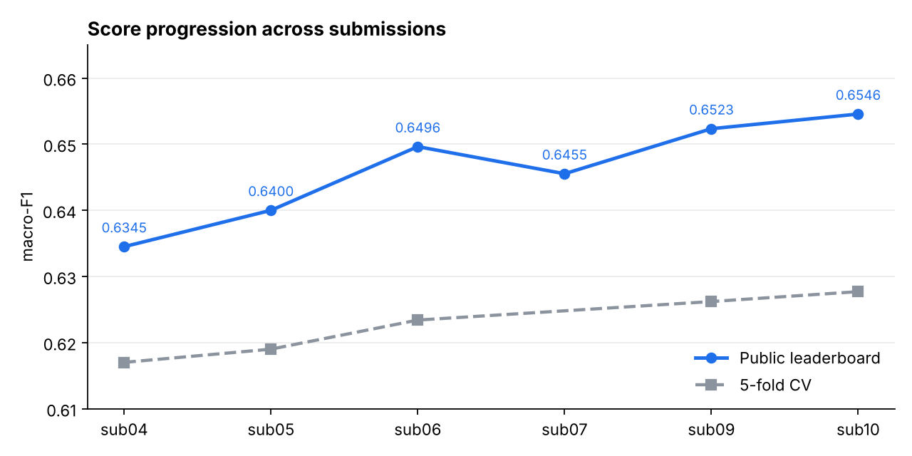
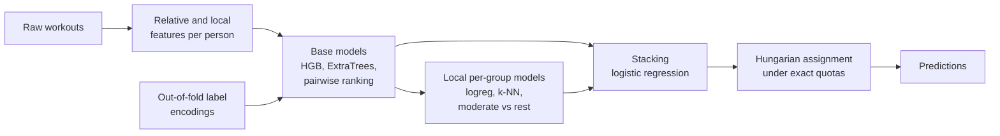

# Workout Intensity Prediction


6-hour machine-learning hackathon on Kaggle: predict whether a workout was **easy**, **moderate** or **hard** *for the person who did it*.

Constraints: scikit-learn only, no neural networks, no external data, 15 submissions maximum. Metric: macro-F1.

| | |
| --- | --- |
| **Final submission** | `sub10_stack_locaux` |
| **Public macro-F1** | **0.65456** |
| **5-fold CV macro-F1** | 0.6277 |
| **Data** | 22,728 labelled workouts, 7,669 to predict, 183 users |



## The three ideas that mattered

**1. The target is relative to the person.**
The label is a tercile, computed per (user, sport), of a hidden sensor measure (most likely heart rate). The same 12 km/h is easy for a marathoner and hard for a beginner, so every feature is expressed against the person's own history: rank, z-score, deviation from median, and deviation from their workouts in the same ±2-month window. Raw speed correlates 0.12 with the target; speed rank within the person's history correlates 0.35.

**2. Exact class quotas in the test set.**
Each (user, sport) group has exactly one third of each class over train + test, and the train labels are known. So the number of easy / moderate / hard left in the test is known for each group. Predictions are assigned with the Hungarian algorithm under these quotas, which is worth about +0.006 macro-F1 by itself. The only rounding convention consistent with all 193 groups sends the extra workout to `hard`.

**3. Label information from the person's other workouts, without leakage.**
Temporal "form of the moment", personal k-NN vote, weekday / time-slot routines and same-route encodings, all computed out-of-fold (a workout never sees its own label).

## Pipeline



| Block | What it does |
| --- | --- |
| HistGradientBoosting, ExtraTrees | Class probabilities from relative features plus label encodings |
| Pairwise ranking | A model learns "which of two workouts of the same person was harder?", then places each workout among the person's known easy / moderate / hard ones |
| Local models | Logistic regression and k-NN per (user, sport), plus an HGB specialised on `moderate` |
| Stacking | Logistic regression on out-of-fold log-probabilities (C = 0.05) |
| Decision | `scipy.optimize.linear_sum_assignment` per (user, sport), cost = -log p |

## Validation

- `StratifiedKFold(5, shuffle=True, random_state=0)`. In CV the unknown set is the validation fold plus the test, with quotas computed from training-fold labels only.
- The public score runs about 0.026 above CV because Kaggle has fewer unknown workouts per group, which makes the quotas more precise.
- A change was adopted only if it won on at least 4 of 5 folds by roughly 0.002 or more.

Per class: F1 easy 0.673, moderate 0.514, hard 0.683. Errors are almost always between neighbouring classes; `moderate` is hardest because it sits between the other two.

## What did not work

Ordinal regression alone, HGB tuning, seed averaging, robust z-scores, HGB meta-model, per-user calibration, extra quota for `moderate`, transductive smoothing, label propagation, 20-fold inner encodings, larger stacks of 7 to 9 models. Retraining on 100% of train (`sub07`) lowered the public score because the meta-model had been fitted on fold models. The full list with numbers is in [`docs/LOG.md`](docs/LOG.md).

Deliberately not used: the original public dataset (it contains the heart rate, which is external data) and tuning on the public leaderboard.

## Repository

```
.
├── notebook_final.ipynb        End-to-end notebook reproducing the sub09 stack
├── src/
│   ├── commun.py               Data loading and cleaning
│   ├── features*.py            Relative, local and expected-speed features
│   ├── encodage*.py            Out-of-fold label encodings
│   ├── etape7_modeles.py       Base models per fold
│   ├── paires*.py              Pairwise ranking model
│   ├── locaux.py               Local per-group models
│   ├── stacking.py, quotas.py  Stacking and quota assignment
│   └── sub10_stack_locaux.py   Final submission script
└── docs/
    ├── LOG.md                  Submission log: hypothesis, CV, public score
    ├── JOURNAL.md              Step-by-step journal (French)
    └── FICHE_EQUIPE.md         Team study sheet (French)
```

## Reproduce

The competition data is not included. Put `train.csv`, `test.csv` and `sample_submission.csv` in `data/`.

```bash
pip install numpy pandas scipy scikit-learn jupyter
jupyter nbconvert --to notebook --execute notebook_final.ipynb
```

The notebook trains the whole sub09 stack end to end (about 30 minutes). Scripts in `src/` are meant to be run from the repository root, for example `python src/etape7_modeles.py`.

Code identifiers are in French (team language); documentation and the submission log are in English.
